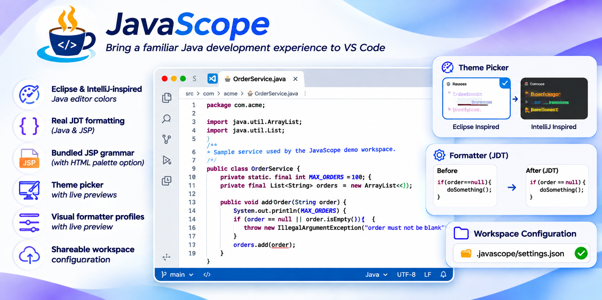
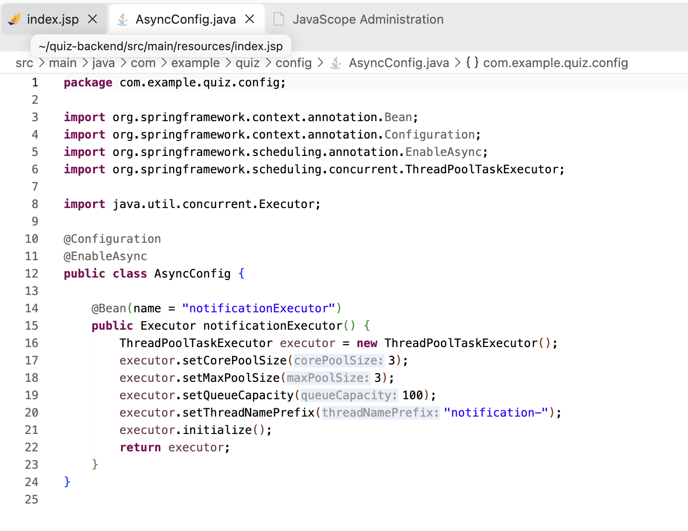
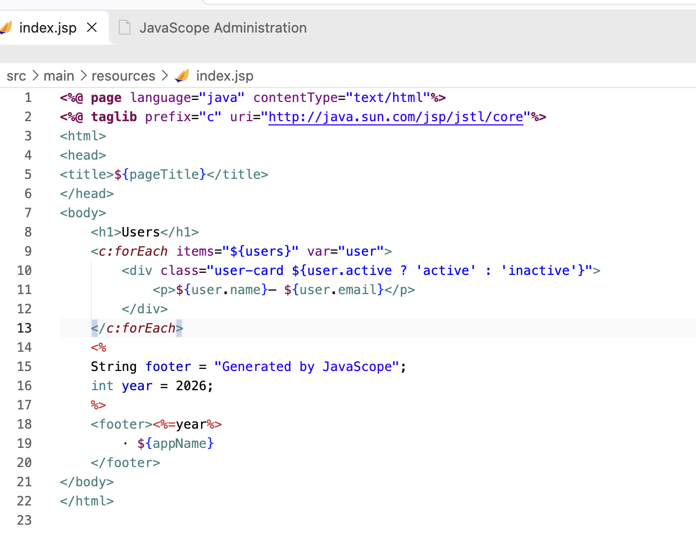
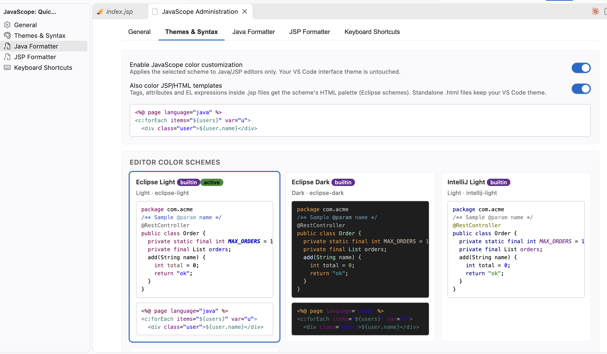
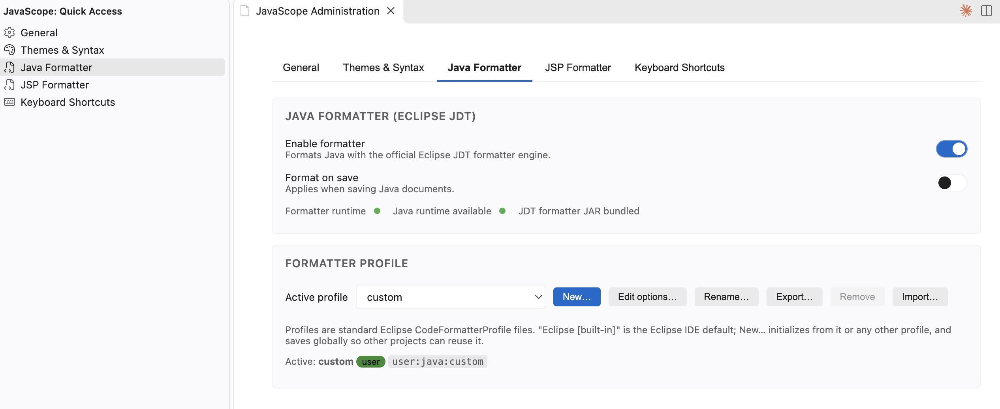
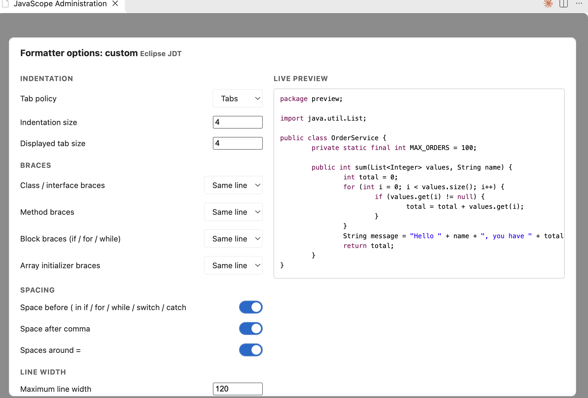

<p align="center">
  
</p>

[English](README.md) | **Español**

**Colores de editor Java inspirados en Eclipse e IntelliJ, y formateo Java/JSP basado en Eclipse JDT para Visual Studio Code.**

<p align="center">
  
  
</p>

JavaScope trae lo mejor de los IDEs clásicos de Java a VS Code sin alterar el ecosistema: complementa a [Language Support for Java de Red Hat](https://marketplace.visualstudio.com/items?itemName=redhat.java) y jamás lo reemplaza ni genera conflictos.

## Características

### Temas y sintaxis

<p align="center"></p>

- Cuatro esquemas integrados — **Eclipse Light**, **Eclipse Dark**, **IntelliJ Light**, **IntelliJ Darcula** — con vista previa en vivo en el panel de administración.
- Solo colorea los tokens del editor; el tema de interfaz de VS Code queda intacto.
- Cobertura completa de la sintaxis Java: clases, interfaces, enums, anotaciones, métodos, campos (azules), constantes (bold italic), variables locales (marrones), parámetros, keywords (púrpura), comentarios, strings, Javadoc — además de directivas JSP, scriptlets y EL (JavaScope incluye una gramática TextMate para JSP).
- Respeta los tokens semánticos del language server de Red Hat (incluido `readonly` para constantes), así los colores son Eclipse-exactos antes y después del análisis.
- **Paleta HTML para JSP** opcional (esquemas Eclipse): tags, atributos y expresiones EL dentro de archivos `.jsp` reciben los colores del editor HTML de Eclipse; los `.html` sueltos nunca se ven afectados.
- Aviso de contraste: si el esquema activo pisa tu tema del workbench, el panel te indica cómo cambiarlo.
- Temas personalizados vía `.javascope/themes/*.json` (ver [Guía de temas](docs/themes.md)).

### Formateo Java — Eclipse JDT real

<p align="center"></p>

- JavaScope integra un **formateador Eclipse JDT** headless (`org.eclipse.jdt.core` 3.42) — la implementación oficial, no una réplica.
- Incluye el **perfil por defecto de Eclipse** (`formatters/java/default.xml`).
- Admite cualquier perfil XML exportado desde Eclipse: *Window → Preferences → Java → Code Style → Formatter → Export*.
- Editor visual de opciones para los ajustes más usados (indentación, llaves, espaciado, ancho de línea) con vista previa en vivo, más el XML completo para el resto de las ~400 opciones.
- Cobertura total de reglas: indentación (tabs/espacios), ancho de línea, posición de llaves, líneas en blanco, wrapping, imports, anotaciones, espaciado y comentarios.

### Formateo JSP — basado en parser

- JSP es contenido mixto, no HTML: el motor JSP de JavaScope tokeniza directivas (`<%@ %>`), declaraciones (`<%! %>`), scriptlets (`<% %>`), expresiones (`<%= %>`), comentarios JSP, expresiones EL (`${…}`), tags JSTL/custom y HTML, y formatea estructuralmente.
- El Java dentro de scriptlets/declaraciones/expresiones se formatea **con el mismo motor Eclipse JDT** (si un fragmento no parsea, se conserva tal cual).
- Documentos con marcado desbalanceado usan un modo conservador que jamás inventa, mueve ni elimina tags.
- Perfiles JSON configurables con editor visual y vista previa: estilo/tamaño de indentación, ancho de línea, wrapping de atributos, líneas en blanco, espacios finales y activación del formateo Java en scriptlets.

### Configuración

- Dos ubicaciones: usuario (`~/.javascope`) y workspace (`<workspace>/.javascope`) — commitea la carpeta para compartir la configuración con tu equipo.
- Precedencia: workspace > usuario > ajustes `javascope.*` de VS Code > valores por defecto.
- Vigilancia de archivos: perfiles y temas soltados en `.javascope` se descubren automáticamente.
- Validación de JSON/XML con mensajes claros (en la UI y el log).

### Administración

<p align="center"></p>

- Panel **JavaScope: Open Administration** basado en React para temas, formateadores, perfiles, toggles y atajos.
- Perfiles: crear, duplicar, renombrar, editar (visual o XML/JSON crudo), eliminar, importar, exportar y activar — con insignias de origen (built-in / usuario / workspace).
- Una vista en la barra de actividad (☕ JavaScope) abre cualquier pestaña de configuración directamente.

## Requisitos

- VS Code 1.85 o superior.
- Un **runtime de Java** (`java` en el PATH) para el formateo Java y el de scriptlets dentro de JSP. Sin él, JavaScope igual ofrece temas y el formateo estructural de JSP.
- El resaltado de sintaxis Java funciona de serie; se recomienda la extensión Red Hat Java para el resaltado semántico e inteligencia de lenguaje (JavaScope se adapta a ella, no al revés).

## Instalación

Desde un VSIX local:

```bash
code --install-extension javascope.vsix
```

Para generar el VSIX desde el código fuente: `npm run package` (ver *Desarrollo* más abajo).

## Inicio rápido

1. Abre el panel de administración con **JavaScope: Open Administration** (o el icono ☕ de la barra de actividad).
2. Elige un esquema en **Themes & Syntax**.
3. Activa **Also color JSP/HTML templates** si quieres la paleta HTML de Eclipse dentro de los `.jsp`.
4. Activa **Format on save** para Java y/o JSP.
5. Importa tu perfil de Eclipse en **Java Formatter → Import…**, o duplica el perfil integrado y ajústalo con **Edit options…**.
6. Commitea `.javascope/` para compartir la configuración con tu equipo.

## Comandos

| Comando | Atajo por defecto |
|---|---|
| JavaScope: Open Administration | — |
| JavaScope: Format Java | `Ctrl/Cmd+Alt+F` (en archivos Java) |
| JavaScope: Format Java Selection | `Ctrl/Cmd+Alt+Shift+F` (Java, con selección) |
| JavaScope: Format JSP | `Ctrl/Cmd+Alt+F` (en archivos JSP) |
| JavaScope: Select Java Formatter Profile | — |
| JavaScope: Select JSP Formatter Profile | — |
| JavaScope: Toggle Java Formatter | — |
| JavaScope: Toggle JSP Formatter | — |
| JavaScope: Toggle JavaScope Themes | — |
| JavaScope: Reload Configuration | — |

Los comandos de formateo también están en el menú contextual del editor y como botón en la barra del título (ocúltalo con clic derecho sobre la barra, o con `"javascope.showEditorActions": false`). El `Shift+Alt+F` estándar de VS Code conserva su comportamiento. Todos los atajos de JavaScope se pueden cambiar o quitar en *Keyboard Shortcuts* — JavaScope nunca toca atajos ajenos.

## Documentación

- [Referencia de configuración](docs/configuration.md)
- [Guía de temas](docs/themes.md)
- [Guía del formateador Java](docs/java-formatter.md)
- [Guía del formateador JSP](docs/jsp-formatter.md)
- [Compartir configuración entre el equipo](docs/workspace-sharing.md)
- [Guía de atajos de teclado](docs/keyboard-shortcuts.md)
- [Limitaciones conocidas](docs/known-limitations.md)

## Desarrollo

```bash
npm install                 # dependencias de la extensión
cd formatters/java/cli && mvn package   # compila el CLI del formateador JDT incluido
cd webview/admin && npm install && npm run build   # compila la UI de administración
npm run build               # empaqueta la extensión
npm test                    # tests unitarios (90 tests)
npm run test:vscode         # tests de integración dentro de VS Code real
npm run package             # genera javascope.vsix
```

Ver [CHANGELOG.md](CHANGELOG.md) y [docs/known-limitations.md](docs/known-limitations.md).

**Assets de marca** (logo y banner de [@erikchaupis](https://github.com/erikchaupis)) en [docs/brand](docs/brand) — reutilízalos tal cual al mencionar JavaScope.

## Licencia

MIT — ver [LICENSE](LICENSE).
