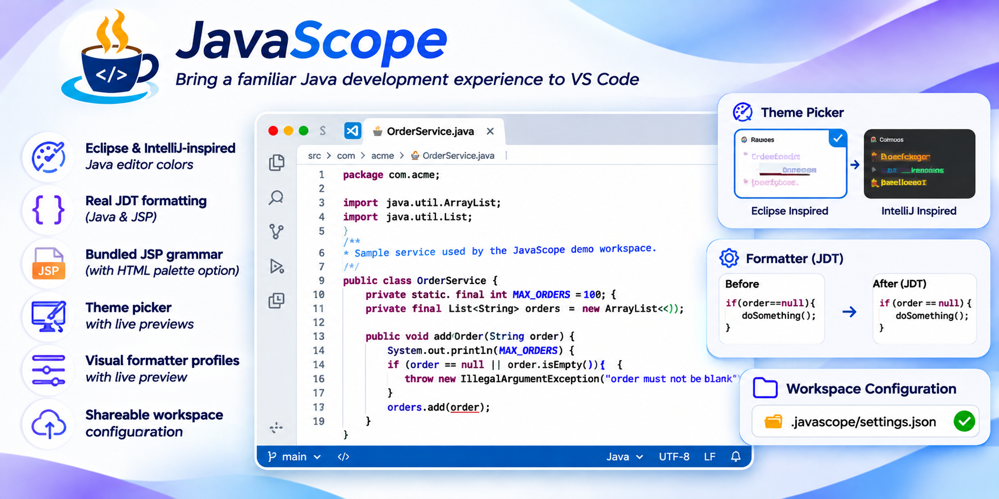
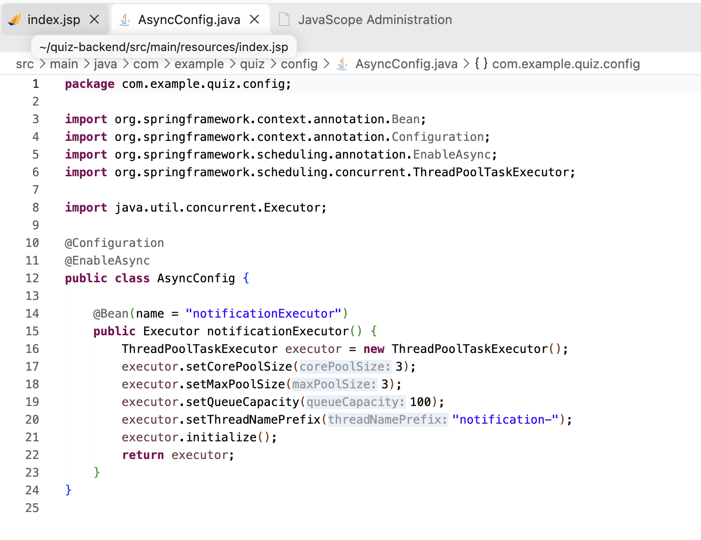
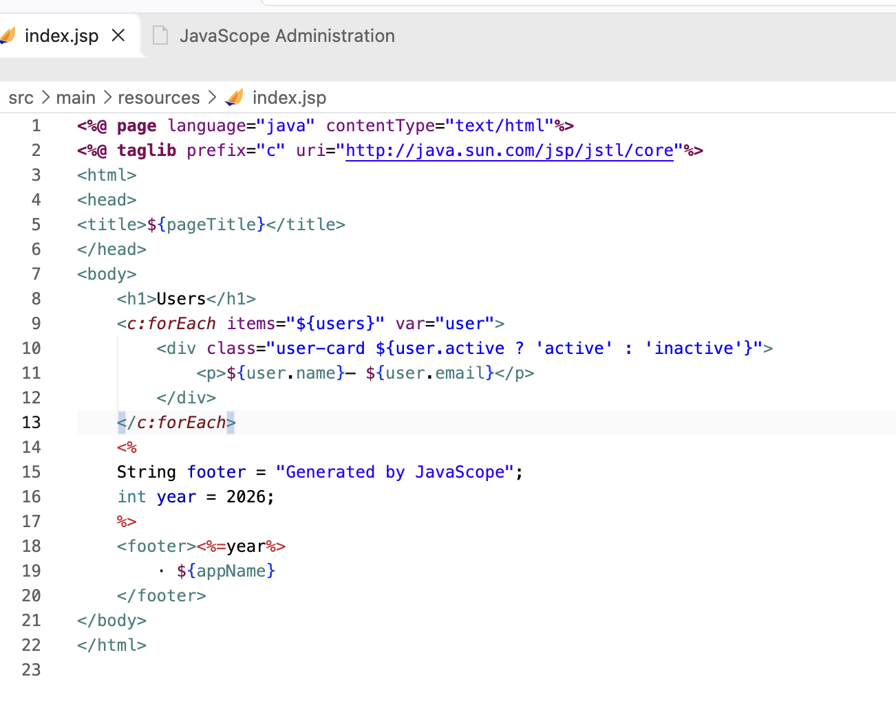
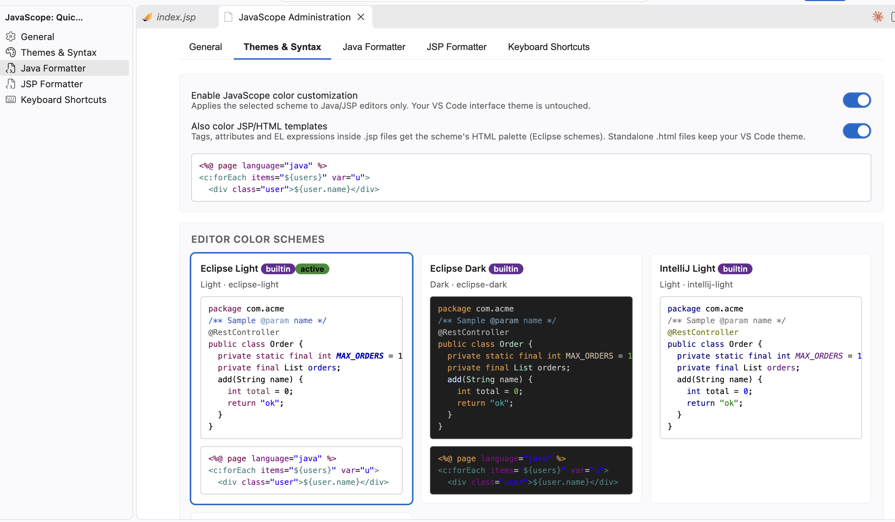
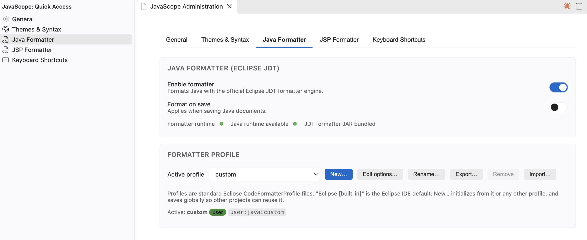
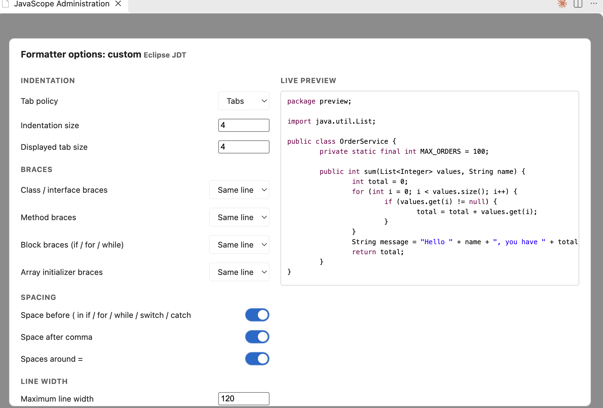

<p align="center">
  
</p>

**English** | [Español](README.es.md)

**Eclipse & IntelliJ-inspired Java editor colors and Eclipse JDT-based Java/JSP formatting for Visual Studio Code.**

<p align="center">
  
  
</p>

JavaScope brings the best of the classic Java IDEs into VS Code without disturbing the Java ecosystem — it complements [Language Support for Java by Red Hat](https://marketplace.visualstudio.com/items?itemName=redhat.java) and never replaces or conflicts with it.

## Features

### Themes & Syntax

<p align="center"></p>

- Four built-in editor color schemes — **Eclipse Light**, **Eclipse Dark**, **IntelliJ Light**, **IntelliJ Darcula** — with live previews in the Administration panel.
- Editor token colors only; your VS Code interface theme stays untouched.
- Full Java syntax coverage: classes, interfaces, enums, annotations, methods, fields (blue), constants (bold italic), local variables (brown), parameters, keywords (purple), comments, strings, Javadoc — plus JSP directives, scriptlets and EL (JavaScope ships a JSP TextMate grammar).
- Matches the Red Hat Java language server's semantic tokens (including `readonly` for constants), so colors stay Eclipse-exact before and after analysis.
- Optional **JSP/HTML template palette** (Eclipse schemes): tags, attributes and EL expressions inside `.jsp` files get the Eclipse HTML editor colors; standalone `.html` files are never affected.
- Dark/light mismatch hint: if the active scheme fights your workbench theme, the panel tells you how to switch.
- Custom themes via `.javascope/themes/*.json` (see [Theme Customization Guide](docs/themes.md)).

### Java formatting — real Eclipse JDT

<p align="center"></p>

- JavaScope embeds a headless **Eclipse JDT formatter** (`org.eclipse.jdt.core` 3.42) — the official implementation, not a re-implementation.
- Ships with the **Eclipse built-in default profile** (`formatters/java/default.xml`).
- Supports any Eclipse formatter XML profile: import profiles exported from Eclipse via *Window → Preferences → Java → Code Style → Formatter → Export*.
- Visual options editor for the most-used settings (indentation, braces, spacing, line width) with a live preview, plus the raw XML for the full ~400-option tail.
- Full rule coverage: indentation (tabs/spaces), line width, brace placement, blank lines, wrapping, imports, annotations, white space, comments.

### JSP formatting — parser-based

- JSP is mixed content, not HTML: the JavaScope JSP engine tokenizes directives (`<%@ %>`), declarations (`<%! %>`), scriptlets (`<% %>`), expressions (`<%= %>`), JSP comments, EL expressions (`${…}`), JSTL/custom tags and HTML, then formats structurally.
- Java inside scriptlets/declarations/expressions is formatted **by the same Eclipse JDT engine** (graceful fallback keeps original code if a snippet does not parse).
- Documents with unbalanced markup fall back to a conservative mode that never invents, moves or removes tags.
- Configurable JSON profiles with a visual options editor and live preview: indentation style/size, line width, attribute wrapping, blank lines, trailing whitespace, scriptlet-Java toggle.

### Configuration

- Two locations: user-level `~/.javascope` and workspace-level `<workspace>/.javascope` (commit the folder to share your whole team's setup).
- Precedence: workspace > user > VS Code `javascope.*` settings > built-in defaults.
- File watching: profiles and themes dropped into `.javascope` folders are discovered automatically.
- Validation of JSON/XML with clear error messages (in the UI and the log).

### Administration

<p align="center"></p>

- React-based **JavaScope: Open Administration** panel for themes, formatters, profiles, toggles and shortcuts.
- Profiles: create, duplicate, rename, edit (visual or raw XML/JSON), delete, import, export, activate — with origin badges (built-in / user / workspace).
- An activity-bar view (☕ JavaScope) opens any settings tab directly.

## Requirements

- VS Code 1.85+.
- A **Java runtime** (`java` on PATH) for Java formatting and scriptlet formatting inside JSP. Without it, JavaScope still provides themes and JSP structure formatting.
- Java syntax highlighting works out of the box; the Red Hat Java extension is recommended for semantic highlighting and language intelligence (JavaScope adapts to it, not the other way around).

## Installation

From a local VSIX:

```bash
code --install-extension javascope.vsix
```

Build the VSIX from source with `npm run package` (see *Development* below).

## Quick start

1. Open the Administration panel with **JavaScope: Open Administration** (or the ☕ activity-bar icon).
2. Pick a color scheme under **Themes & Syntax**.
3. Enable **Also color JSP/HTML templates** if you want the Eclipse HTML palette inside `.jsp` files.
4. Enable **Format on save** for Java and/or JSP.
5. Import your Eclipse formatter profile under **Java Formatter → Import…**, or duplicate the built-in profile and tune it with **Edit options…**.
6. Commit `.javascope/` to your repository to share the setup with your team.

## Commands

| Command | Default keybinding |
|---|---|
| JavaScope: Open Administration | — |
| JavaScope: Format Java | `Ctrl/Cmd+Alt+F` (in Java files) |
| JavaScope: Format Java Selection | `Ctrl/Cmd+Alt+Shift+F` (Java, with a selection) |
| JavaScope: Format JSP | `Ctrl/Cmd+Alt+F` (in JSP files) |
| JavaScope: Select Java Formatter Profile | — |
| JavaScope: Select JSP Formatter Profile | — |
| JavaScope: Toggle Java Formatter | — |
| JavaScope: Toggle JSP Formatter | — |
| JavaScope: Toggle JavaScope Themes | — |
| JavaScope: Reload Configuration | — |

The format commands are also in the editor right-click menu and as a button in the editor title bar (hide it via right-click on the title bar, or set `javascope.showEditorActions` to `false`). VS Code's standard `Shift+Alt+F` keeps its default behavior. All JavaScope keybindings can be changed or removed in *Keyboard Shortcuts* — JavaScope never touches unrelated bindings.

## Documentation

- [Configuration Reference](docs/configuration.md)
- [Theme Customization Guide](docs/themes.md)
- [Java Formatter Guide](docs/java-formatter.md)
- [JSP Formatter Guide](docs/jsp-formatter.md)
- [Workspace Sharing Guide](docs/workspace-sharing.md)
- [Keyboard Shortcuts Guide](docs/keyboard-shortcuts.md)
- [Known Limitations](docs/known-limitations.md)

## Development

```bash
npm install                 # extension dependencies
cd formatters/java/cli && mvn package   # build the bundled JDT formatter CLI
cd webview/admin && npm install && npm run build   # build the admin UI
npm run build               # bundle extension
npm test                    # unit tests (90 tests)
npm run test:vscode         # integration tests inside real VS Code
npm run package             # produce javascope.vsix
```

See [CHANGELOG.md](CHANGELOG.md) and [docs/known-limitations.md](docs/known-limitations.md).

**Brand assets** (logo and banner by [@erikchaupis](https://github.com/erikchaupis)) live in [docs/brand](docs/brand) — please reuse them as-is when mentioning JavaScope.

## License

MIT — see [LICENSE](LICENSE).
